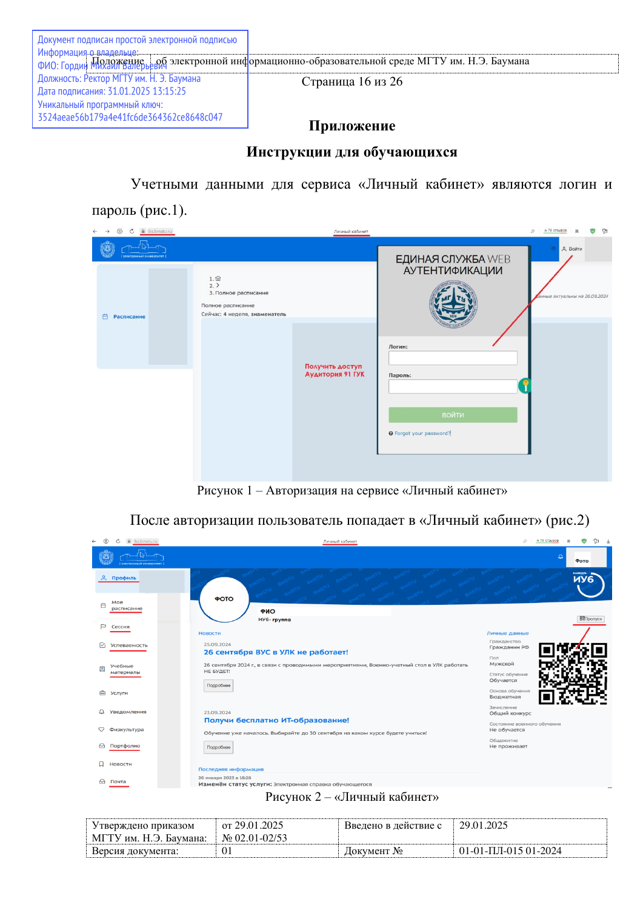
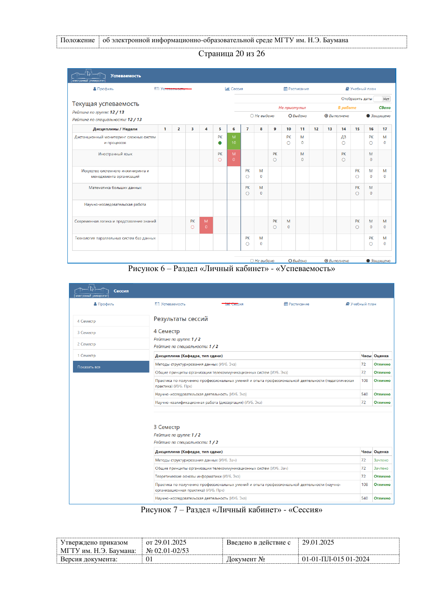
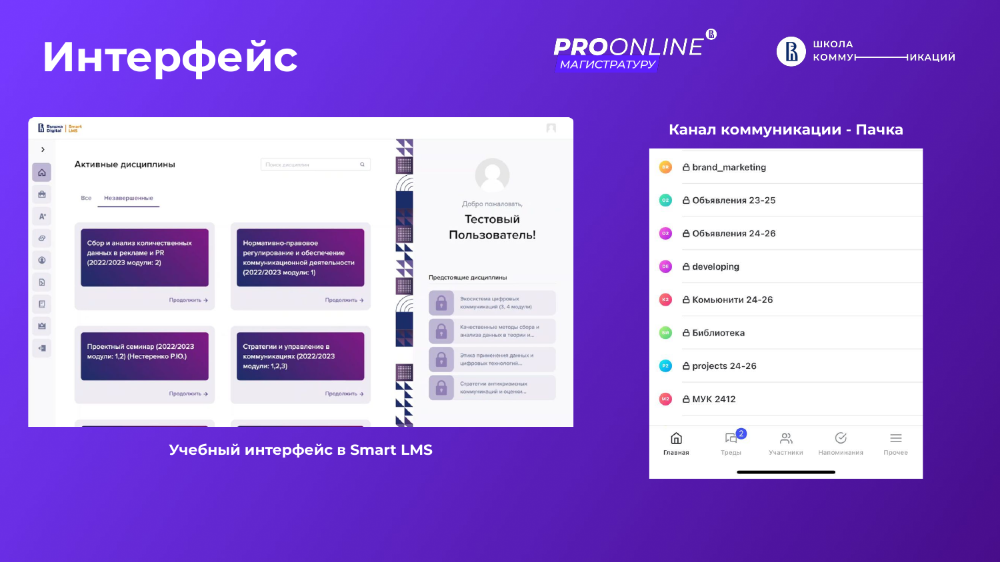
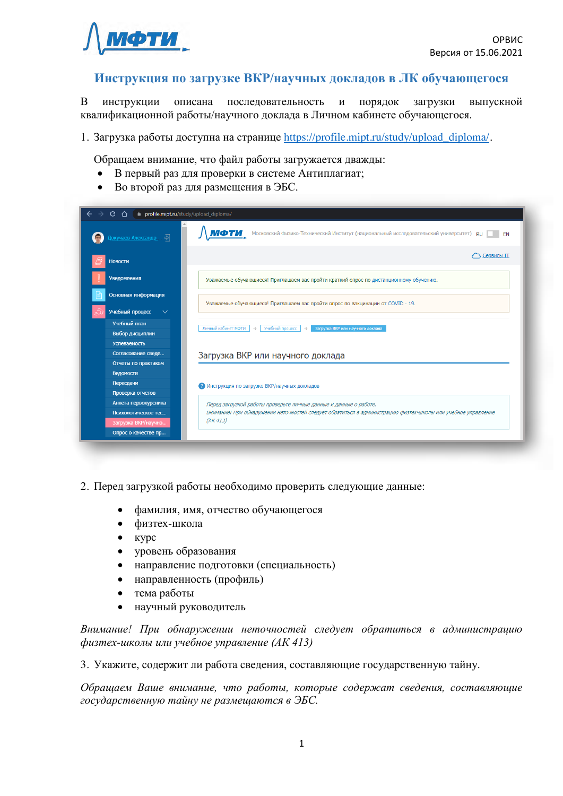
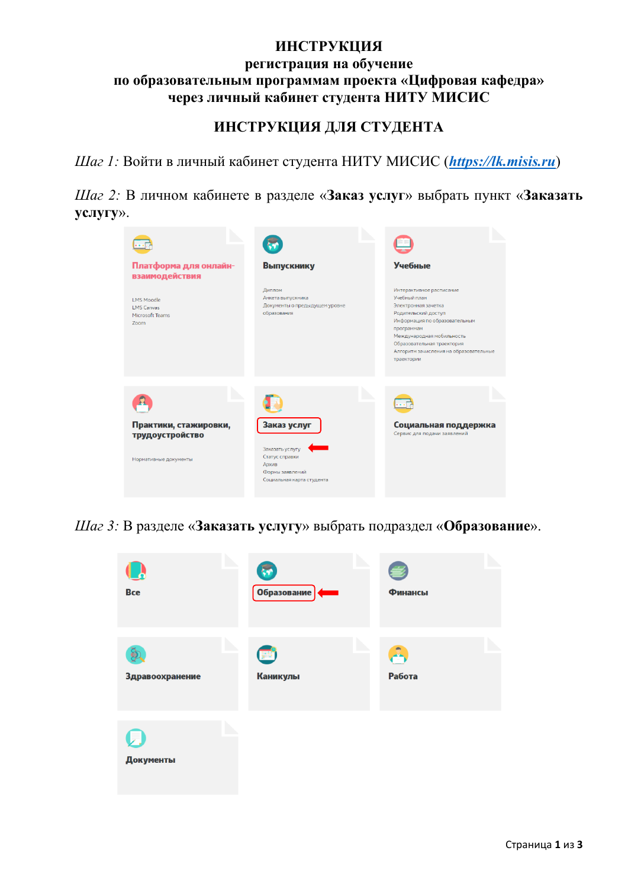

# Визуальные материалы

Просмотрено 20.11.2026. Ниже страницы публичных официальных документов, преобразованные в PNG и визуально проверенные. Это первоисточники для анализа, а не созданные нами макеты. Нумерация означает страницу сохранённого PDF; печатный номер внутри документа иногда отличается.

Персональные экраны пользователя из ИТМО здесь отсутствуют: их структура описана в [наблюдениях](ITMO_OBSERVATIONS.md). Для вузов без открытых внутренних изображений внешний вид не реконструировался по догадке.

## МГТУ им. Баумана: вход и кабинет

[Оригинальный PDF](https://mf.bmstu.ru/sveden/files/ric/Instrukciya_po_rabote_s_EIOS_MGTU_2025.pdf), [локальная копия](sources/bmstu-eios-2025.pdf), страница 1 (печатная 16). Инструкция введена в действие в январе 2025 года; на снимках внутри есть даты сентября 2024 года. Синяя шапка, левое меню, профиль, новостная область; отдельная форма единой аутентификации.

## МГТУ им. Баумана: текущая успеваемость и сессия

Тот же документ, страница 5 (печатная 20). Верхний экран - матрица дисциплин по неделям с легендой состояний. Нижний - итоговые результаты по семестрам. Хорошо видна разница между текущим ходом обучения и аттестацией.

## ВШЭ: SmartLMS в материалах онлайн-программы

[Оригинальная презентация](https://www.hse.ru/data/2025/04/11/1950072834/%D0%A3%D0%A1%D0%9A%2025.03.2025.pdf), [локальная копия](sources/hse-smartlms-2025.pdf), страница 9. Презентация от 25.03.2025, на снимке курсы 2022/2023. Слева учебная система с карточками дисциплин; справа отдельный канал коммуникации «Пачка». Эти два изображения не являются одним интерфейсом. Пример конкретной программы не доказывает одинаковый дизайн у всех студентов ВШЭ.

## МФТИ: историческая структура кабинета

[Локальная копия официальной инструкции](sources/mipt-student-cabinet.pdf), страница 1; исходный URL указан в [метаданных загрузки](sources/downloads.json). Версия от 15.06.2021. Вложенное меню «Учебный процесс», хлебные крошки, уведомления и рабочая область загрузки ВКР. Изображение не подтверждает нынешний дизайн. Никакие файлы в МФТИ не загружались.

## НИТУ МИСИС: рубрики кабинета и услуги

[Оригинальная инструкция](https://misis.ru/files/-/7927857009cec331b902f4884501abe2/reg.pdf), [локальная копия](sources/misis-service-interface.pdf), страница 1. Дата не установлена. Видны тематические плитки и отдельные ссылки заказа, статуса и архива услуг. На изображении есть упоминания Moodle и Canvas; актуальное [официальное описание](https://misis.ru/students/portal/) на момент чтения называет Moodle. Снимок следует использовать с этой оговоркой.

## Другие найденные визуальные источники и пробелы

- СПбПУ: [публичная инструкция мобильного доступа](https://my.spbstu.ru/instructions/install-on-phone/) содержит изображения шагов. Она не заменяет осмотр содержания студенческого кабинета.
- МГИМО: загрузка найденной памятки вернула HTML; страницы не удалось визуально проверить. В галерее нет выдуманного изображения ЛК.
- МГУ, СПбГУ, МИФИ, НГУ, ТГУ, УрФУ, Иннополис, Московский Политех: в рамках исследования не подтверждён достаточный набор открытых актуальных внутренних снимков для визуальной оценки. Официальные описания функций приведены [в сравнении](COMPARISON.md).

Эти изображения не включаются в интерфейс конкурсного продукта. Знаки университетов и сведения из их публичных примеров остаются частью исследовательских первоисточников; демонстрационные данные нашего решения должны быть вымышлены.
